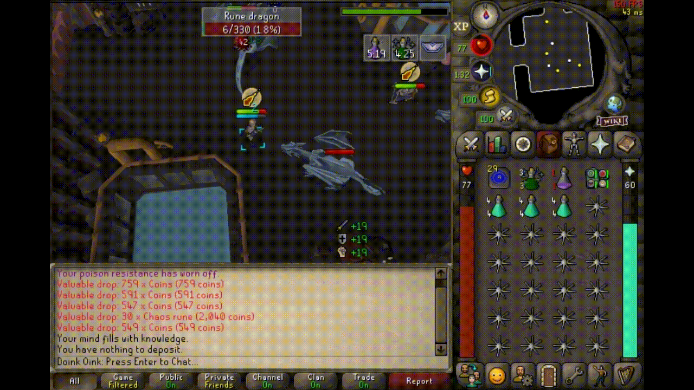

<h1></h1>

Displays a list of recently received loot on screen with a configurable price threshold.

## Display Settings
<ins>Icon Size:</ins>\
How big item icons will be.

<ins>Max Displayed Items:</ins>\
How many items can be shown at once.

<ins>Max Display Time:</ins>\
How long the last item in the list will be displayed on screen. If set to 0 it will show until the max item displayed has been reached.

<ins>Minimum Value:</ins>\
The minimum value an item must be to be displayed.

<ins>Space Between Icons and Text:</ins>\
How much space is between an items icon and text.

<ins>Space Between Items:</ins>\
How much vertical space is between each displayed item.

<ins>Text Color:</ins>\
What color the text displays in.

<ins>Time Remove Method:</ins>\
What method should be used to remove items from the list. One At A Time: Remove items one at a time with each item taking the Max Display Time. By Drop Group: Remove all items from the same drop at the same time. Time Since Last Drop: Items will only disappear if an item isn't added within the Max Display Time.

<ins>NPC Specific Values:</ins>\
Comma separated display values per NPC. To add an NPC put their {name or NPC ID}:{min value}/nExample: Cow:100,Goblin:20

## Animation Settings
<ins>Direction to appear from:</ins>\
Which side the items should appear and disappear from.

<ins>Item Stack Direction:</ins>\
What direction items should stack in the list.

<ins>Horizontal Scroll Speed:</ins>\
How fast the text will scroll left and right.

<ins>Vertical Scroll Speed:</ins>\
How fast the text will scroll up and down.
